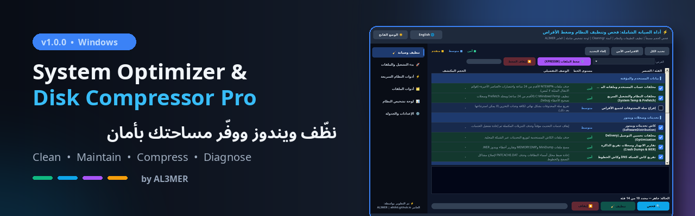
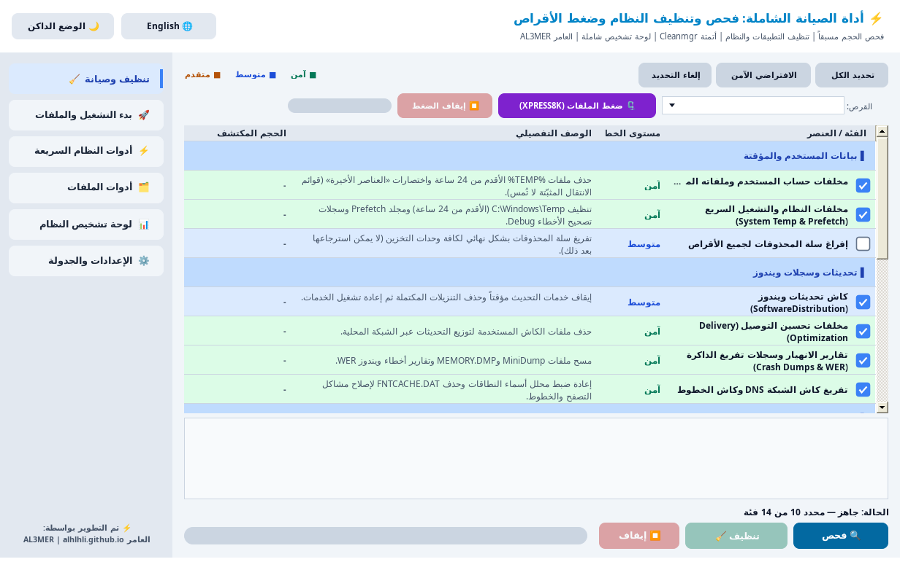
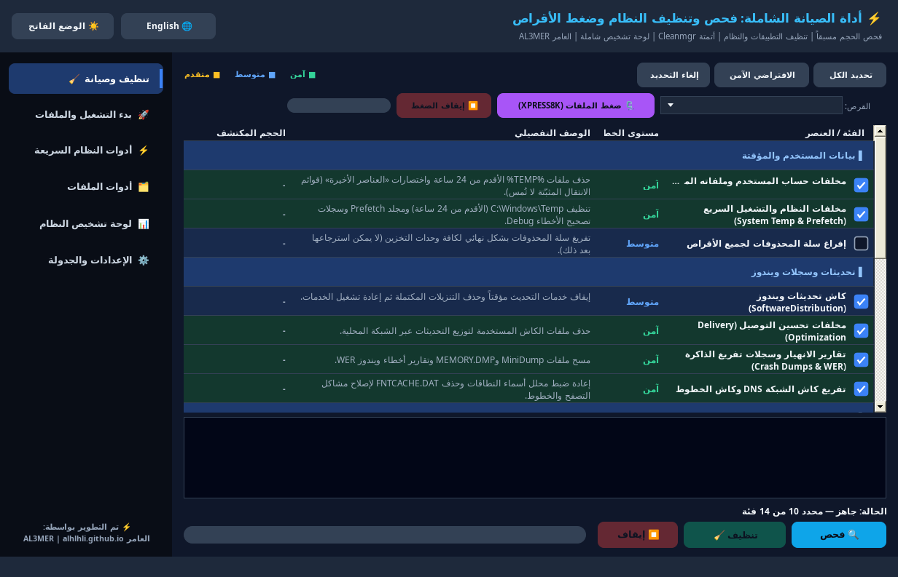
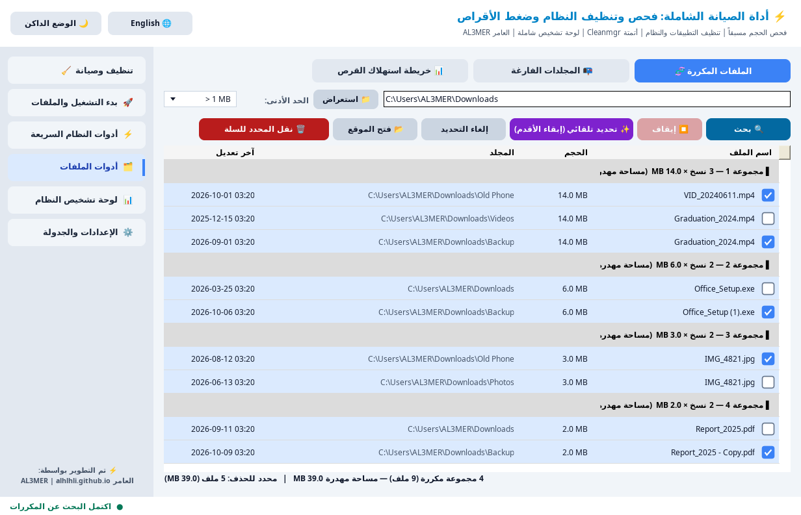
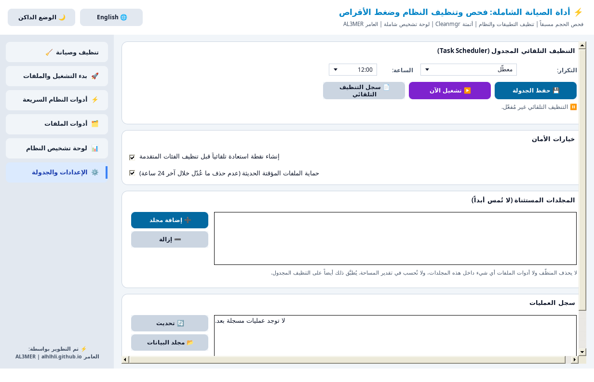
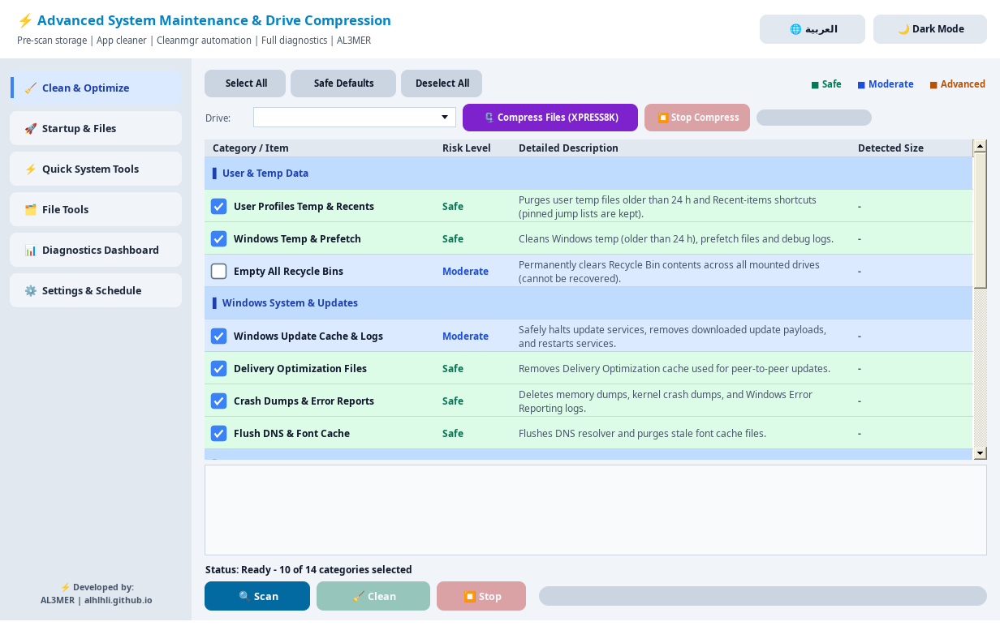

<div align="center">



# System Optimizer & Disk Compressor Pro

<p dir="rtl"><b>أداة واحدة لتنظيف ويندوز وصيانته وضغط ملفاته… بأمان 🛡️</b></p>
<p dir="ltr"><i>Clean, maintain and compress Windows from one app, safely.</i></p>

    

<a href="https://github.com/Alhlhli/System-Optimizer-Disk-Compressor-Pro/raw/main/System%20Optimizer%20%26%20Disk%20Compressor%20Pro.exe">
  
</a>

<p dir="rtl"><b><a href="https://github.com/Alhlhli/System-Optimizer-Disk-Compressor-Pro/raw/main/System%20Optimizer%20%26%20Disk%20Compressor%20Pro.exe">⬇️ تحميل مباشر للبرنامج (EXE)</a></b> · <a href="https://alhlhli.github.io/">🌐 موقع المطوّر</a> · <a href="#english">English</a></p>

<!-- بعد إنشاء Release يمكن استبدال رابط التحميل بهذا الرابط الثابت لآخر إصدار:
https://github.com/Alhlhli/System-Optimizer-Disk-Compressor-Pro/releases/latest -->

</div>

<div dir="rtl">

## 📑 المحتويات

- [نبذة](#about)
- [صور البرنامج](#screenshots)
- [المميزات](#features)
- [لماذا تثق به؟](#safety)
- [المتطلبات](#requirements)
- [التحميل والاستخدام](#usage)
- [البناء من المصدر](#build)
- [المطوّر](#credits)
- [English summary](#english)

<a id="about"></a>
## 💡 نبذة

برنامج **System Optimizer & Disk Compressor Pro** لويندوز يجمع في واجهة واحدة:
**تنظيف المخلفات 🧹 + أدوات صيانة النظام ⚡ + ضغط الملفات لتوفير المساحة 🗜️ + لوحة تشخيص للجهاز 📊**.

صُمّم ليحمي ملفاتك ولا يحذف ما لا يجب حذفه: يعرض المساحة القابلة للحذف قبل أي تنظيف، والحذف في أدوات الملفات يتم إلى سلة المحذوفات.

<a id="screenshots"></a>
## 🖼️ صور البرنامج

<div align="center">



<sub>🧹 تنظيف وصيانة: كل فئة مع مستوى خطورتها ووصفها، وزر «الافتراضي الآمن»</sub>

<br><br>

<table>
  <tr>
    <td align="center" width="50%"><br><sub>🌙 الوضع الداكن</sub></td>
    <td align="center" width="50%"><br><sub>⚡ أدوات النظام السريعة</sub></td>
  </tr>
  <tr>
    <td align="center"><br><sub>🗂️ أدوات الملفات: المكررات، المجلدات الفارغة، خريطة القرص</sub></td>
    <td align="center"><br><sub>⚙️ الإعدادات والجدولة والمجلدات المستثناة</sub></td>
  </tr>
</table>

</div>

<a id="features"></a>
## ✨ المميزات

### 🧹 التنظيف والصيانة

فحص ذكي يعرض المساحة القابلة للحذف قبل التنظيف 🔍 ثم تختار ما تريد، مع زر **«الافتراضي الآمن»** ✅

| الفئة | الفئة |
|---|---|
| 📁 مخلفات حساب المستخدم وملفاته المؤقتة | 🪟 مخلفات النظام والتشغيل السريع (System Temp & Prefetch) |
| 🔄 كاش تحديثات ويندوز (SoftwareDistribution) | 📡 مخلفات تحسين التوصيل (Delivery Optimization) |
| 💥 تقارير الانهيار وتفريغ الذاكرة (Crash Dumps & WER) | 🌐 تفريغ كاش DNS وكاش الخطوط |
| 🎮 كاش برامج المحادثة والألعاب (Discord, Slack, Teams, Spotify, Steam, VS Code) | 🎨 كاش التظليل الرسومي (DirectX, NVIDIA, AMD) |
| 🖼️ كاش الصور المصغرة والأيقونات | 📦 حزم التثبيت اليتيمة (Orphaned MSI/MSP) |
| 🧽 تنظيف القرص العميق عبر أتمتة Cleanmgr | 🗂️ مجلد التثبيتات السابقة (Windows.old) |
| 📄 الملفات الفارغة (0 بايت) داخل مجلدات الكاش | 🗑️ إفراغ سلة المحذوفات (اختياري وغير محدد افتراضياً) |

### 🗜️ ضغط الملفات وتوفير المساحة

- 🗜️ ضغط الملفات بخوارزمية **XPRESS8K**، ولقرص النظام يستخدم الوضع الرسمي **CompactOS** الذي يستثني ملفات الإقلاع الحرجة تلقائياً
- 📦 إلغاء ضغط الملفات بضغطة زر
- 🗄️ تحرير المساحة المحجوزة (Reserved Storage)
- 📏 قياس مساحات النظام (WinSxS وحزم التثبيت وسلة المحذوفات)

### ⚡ أدوات النظام السريعة

- 🛡️ إنشاء نقطة استعادة مع التحقق الفعلي من إنشائها
- 🔧 فحص ملفات النظام (SFC) · 🧪 فحص القرص (CHKDSK)
- ⚙️ إصلاح مخزن المكونات (DISM) · 🔎 فحص صحة المكونات · 🧹 تنظيف مخزن WinSxS
- ⚡ تفريغ كاش DNS · 🔄 إعادة ضبط Winsock · 🌐 تجديد عنوان IP
- 😴 تعطيل / تفعيل السبات · 🚀 خطة الأداء العالي · 🧠 تفريغ الذاكرة (Trim RAM)

### 🚀 بدء التشغيل والملفات

- 🚀 مدير بدء التشغيل: تعطيل / تفعيل البرامج التي تعمل مع ويندوز
- 📦 مستكشف الملفات الكبيرة مع النقل لسلة المحذوفات

### 📊 لوحة تشخيص النظام

تقرير HTML شامل لعتاد جهازك ونظامك 🖥️ يمكن فتحه في المتصفح 🌐 أو طباعته 🖨️، بالوضعين الداكن والفاتح وباللغتين.

### 🗂️ أدوات الملفات والإعدادات

- 🧬 **الباحث عن الملفات المكررة:** مقارنة على 3 مراحل (الحجم ← بصمة جزئية ← **SHA-256** كاملة)، وتحديد تلقائي يُبقي الأقدم، ولا يسمح أبداً بحذف كل النسخ
- 📭 **الباحث عن المجلدات الفارغة:** لا يقترح جذر القرص ولا مجلداتك الشخصية ولا مجلدات النظام
- 📊 **خريطة استهلاك القرص:** أشرطة ملونة بالحجم والنسبة، وتنقّل فوري بين المجلدات
- ⏰ **التنظيف التلقائي المجدول:** يومياً / أسبوعياً / شهرياً عبر Task Scheduler، للفئات الآمنة فقط، ولا يفرّغ سلة المحذوفات
- 🚫 **المجلدات المستثناة (Whitelist):** أضف أي مجلد ولن يُمس أبداً
- 🛡️ **خيارات الأمان وسجل العمليات:** نقطة استعادة تلقائية + حماية ملفات Temp الحديثة + سجل آخر 200 عملية

### 🎨 الواجهة

- 🌙 وضع داكن و☀️ وضع فاتح
- 🇸🇦 واجهة عربية كاملة باتجاه RTL، و🇬🇧 واجهة إنجليزية
- 🧭 شريط جانبي منظّم: تنظيف وصيانة • بدء التشغيل والملفات • أدوات النظام السريعة • أدوات الملفات • لوحة التشخيص • الإعدادات والجدولة

<a id="safety"></a>
## 🛡️ لماذا تثق به؟

- ✅ الحذف في أدوات الملفات والملفات الكبيرة يتم **إلى سلة المحذوفات**، ويُنبّهك ويندوز قبل أي حذف نهائي
- ✅ نقطة استعادة تلقائية قبل تنظيف الفئات المتقدمة
- ✅ لا يحذف ملفات Temp المعدّلة خلال آخر 24 ساعة (قابل للتغيير من الإعدادات)
- ✅ يحمي ملفات النظام والمسارات الحساسة، ولا يمس نسخ File History ولا مجلد التنزيلات ولا العناصر المثبّتة في شريط المهام
- ✅ تحذير واضح عند اختيار فئات لا يمكن التراجع عنها
- ✅ نسخة واحدة فقط تعمل في نفس الوقت، وسجل أخطاء بدل الإغلاق المفاجئ

> 💡 **نصيحة:** يُفضّل إنشاء نقطة استعادة قبل أول تنظيف، ومراجعة الفئات المحددة قبل الضغط على «تنظيف».

<a id="requirements"></a>
## 💻 المتطلبات

| المتطلب | التفاصيل |
|---|---|
| 🪟 النظام | Windows |
| ⚙️ الإطار | إطار عمل ‎.NET Framework 4.x‎ (مبني على الإصدار 4.8) |
| 🔑 الصلاحيات | صلاحيات المسؤول (Administrator)، والبرنامج يطلبها تلقائياً عند التشغيل |

<a id="usage"></a>
## 📥 التحميل والاستخدام

1. 📥 [حمّل البرنامج من هنا](https://github.com/Alhlhli/System-Optimizer-Disk-Compressor-Pro/raw/main/System%20Optimizer%20%26%20Disk%20Compressor%20Pro.exe) ثم شغّله ووافق على طلب صلاحيات المسؤول
2. 🧹 من «تنظيف وصيانة» اضغط **«الافتراضي الآمن»** ثم **🔍 فحص**
3. 👀 راجع المساحة القابلة للحذف وعدّل الفئات كما تريد
4. ✨ اضغط **🧹 تنظيف** وانتظر انتهاء العملية
5. ⏰ (اختياري) من «الإعدادات والجدولة» فعّل التنظيف التلقائي وأضف مجلداتك المستثناة

> 📝 **ملاحظة:** قد يعرض Windows SmartScreen تحذيراً لأن الملف غير موقّع رقمياً. اضغط «مزيد من المعلومات» ثم «تشغيل على أي حال» إذا كنت حمّلته من هذه الصفحة.

يحفظ البرنامج إعداداته وسجلاته في المجلد `%AppData%\SystemOptimizerPro\`:

- الإعدادات: `settings.ini`
- سجل العمليات: `history.log`
- سجل التنظيف المجدول: `autoclean.log`
- سجل الأخطاء: `error.log`

<a id="build"></a>
## 🛠️ البناء من المصدر

البرنامج ملف C# واحد (`CleanerApp.cs`) بمستوى C# 5 ومكتبات WinForms القياسية فقط. للترجمة على ويندوز باستخدام أداة csc المرفقة مع ‎.NET Framework‎:

</div>

```bat
C:\Windows\Microsoft.NET\Framework64\v4.0.30319\csc.exe /nologo /target:winexe /optimize+ /out:SystemOptimizerPro.exe /r:System.Windows.Forms.dll /r:System.Drawing.dll CleanerApp.cs

REM Optional: add  /win32icon:icon.ico  to embed an icon
```

<div dir="rtl">

<a id="credits"></a>
## 👨‍💻 المطوّر

تطوير وبرمجة: **AL3MER** · [alhlhli.github.io](https://alhlhli.github.io/)

⭐ إذا أعجبك البرنامج لا تنسَ إضافة نجمة للمستودع، ويسعدني سماع اقتراحاتك عبر [Issues](https://github.com/Alhlhli/System-Optimizer-Disk-Compressor-Pro/issues).

جميع الحقوق محفوظة © AL3MER.

</div>

---

<a id="english"></a>
## 🇬🇧 English summary

**System Optimizer & Disk Compressor Pro** is a Windows utility (C# / WinForms, .NET Framework 4.8) that combines a junk cleaner, quick system-maintenance tools, NTFS file compression and a hardware diagnostics report in one app, with a full Arabic (RTL) and English interface and dark/light themes.

<p align="center"></p>

- **Clean & Optimize:** pre-scan shows reclaimable space for 14 categories (user/system temp, Windows Update cache, Delivery Optimization, crash dumps, DNS/font cache, app & shader caches, thumbnails, orphaned MSI/MSP, Cleanmgr automation, Windows.old, empty files, Recycle Bin), with a one-click **Safe Defaults** preset.
- **Disk compression:** XPRESS8K compression (CompactOS on the system drive), decompression, Reserved Storage release, system-area measurement.
- **Quick system tools:** restore point (verified), SFC, CHKDSK, DISM, WinSxS cleanup, DNS flush, Winsock reset, IP renew, hibernation toggle, High Performance plan, Trim RAM.
- **Startup & files:** startup manager, large-file explorer.
- **File tools:** duplicate finder (size → partial hash → full SHA-256), empty-folder finder, disk usage map.
- **Settings:** scheduled auto-clean (Task Scheduler, safe categories only), folder whitelist, safety options, history of the last 200 operations.
- **Safety:** file-tool deletions go to the Recycle Bin, automatic restore point before advanced cleaning, recent temp files (< 24 h) are kept, protected system paths, File History, Downloads and pinned jump lists are never touched.

**Requirements:** Windows, .NET Framework 4.x (built for 4.8), administrator rights (requested automatically).

**[⬇️ Download the .exe](https://github.com/Alhlhli/System-Optimizer-Disk-Compressor-Pro/raw/main/System%20Optimizer%20%26%20Disk%20Compressor%20Pro.exe)** · Developer: **AL3MER** · [alhlhli.github.io](https://alhlhli.github.io/) · All rights reserved.
